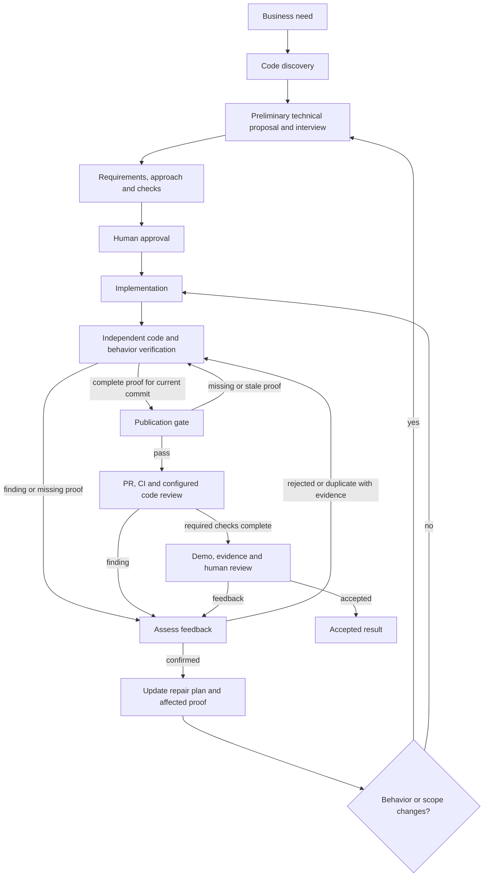

# AI Dev Workflows

Business need → code discovery and technical interview → agreed proposal → human
approval → implementation, behavioral proof and code review → PR checks → human review.
Feedback is assessed and added to the plan before another implementation pass.
Native agents execute the workflow; the [blueprint](feature_execution_blueprint.md)
defines its rules.

## How to use

### 1. Install or refresh in an application

Open the **application repository** in Cursor, Claude Code, or Codex.
Use a local checkout of this source repository at the commit you want to install.
Replace `<source-repo>` with its absolute path and `<provider>` with your tool,
then paste into the agent chat:

```text
Read <source-repo>/skills/workflow-setup/SKILL.md.
Set up this workflow in the current application for <provider>.
If already installed, update the package from this source checkout's HEAD.
Preserve project rules, local edits, and batch documents.
Report the installed blueprint revision, source commit, and package verification.
Do not implement application code.
```

The agent installs the package in `ai-workflow/tooling/` and exposes five skills.
Setup updates the blueprint **and all five skills together**, including `prepare`,
`deliver`, `feedback` and `resume`. They do not need separate updates.
Open a **new chat** and confirm that `workflow-prepare` appears in the skill picker.
Repeat this step after source updates; application copies do not update automatically.
Use the same source commit for repeatable team installations.

Once setup is available, refresh with this shorter prompt:

```text
/workflow-setup Update the package from HEAD of <source-repo>. Preserve project
rules and batch documents. Verify the package and report the installed source commit.
```

In Codex, use `$workflow-setup`. `HEAD` means the current commit in that local source
checkout, not the latest remote commit or uncommitted edits. Commit source changes
before installing them. Open a new application chat after the update.

### 2. Run a change

These are chat inputs. Replace `<need>`, `<batch>`, and `<feedback>` with your request.
The agent supplies the batch ID during preparation.

| Action | Cursor / Claude Code | Codex |
| --- | --- | --- |
| Prepare a proposal | `/workflow-prepare <need>` | `$workflow-prepare <need>` |
| Approve and deliver | `/workflow-deliver <batch>` | `$workflow-deliver <batch>` |
| Apply feedback | `/workflow-feedback <batch> <feedback>` | `$workflow-feedback <batch> <feedback>` |
| Resume interrupted work | `/workflow-resume <batch>` | `$workflow-resume <batch>` |

`prepare` first shows a preliminary solution: user behavior, technical changes,
interfaces and a flow diagram when useful. It asks only about unresolved expectations
and trade-offs, then turns the answers into a short proposal and verification plan.
It does not make you choose private helpers or repeat settled requirements.

Before `deliver`, review the proposed outcome, technical changes, risks,
and verification. The command approves the exact presented proposal and delivery
scope, including its commit/push/PR authority and destination. Missing authority
must be resolved first. At PR review, accept the result or send feedback.
Merge and deployment require separate authority; `resume` reuses existing approval.



One coordinator owns the result. A plan review is optional when a specific design
risk remains. Delivery always separates the implementer from the verifier, who
checks the approved scenarios and actual code before publication. Repairs first
enter the plan with a regression check, then receive focused confirmation.
`deliver` runs those stages under the existing approval; `resume` restores the
unfinished stage. There is no additional command for the operator.

The [publication checker](skills/workflow-deliver/references/publication-gate.md)
checks a verifier's receipt against the current commit, plan revisions, required
check IDs, separate approved-behavior obligations, known finding IDs and retained
evidence files. Missing obligations or omitted known findings block even when
all listed tests pass. Receipt schema 2 requires reassessment of older receipts;
the workflow document schema remains 4. Missing or stale proof blocks handoff.
It does not authenticate the verifier or prove a test's meaning, and it is not a
Git hook. The coordinator must inspect the evidence and obey the result. If no
independent execution facility is available, record a blocker rather than silently
substituting self-review. Pending CI or remote review also keeps delivery active.

### 3. Check the installed version

In the application chat, replace the source path and ask:

```text
/workflow-setup Check the installed package version, integrity, and currentness
against <source-repo>, without changing files.
```

In Codex, use `$workflow-setup`. Each command identifies the blueprint revision
and recorded source commit. Setup checks file contents against that commit;
an intact older copy can still report an available update. Without access to the
source, verification is reported as unavailable.

Read the result as follows:

- **Blueprint revision + recorded source commit:** which package was installed.
  This is separate from the application's own Git commit.
- **Integrity: verified:** installed files match the recorded source commit,
  including the skill instructions.
- **Currentness: matches local source HEAD:** package contents also match the
  checked local source HEAD. `update available` means an intact older package;
  `unverified` means freshness has not been established.

A skill appearing in the picker confirms discovery, not its version. The comparison
above verifies the files. An update can work locally before the application changes
are committed; commit those installed files to share the version with the team.

## Details and checks

[Installation and updates](skills/install.md) ·
[Approval presentation](feature_execution_blueprint.md#approval-presentation) ·
[Session handoffs](feature_execution_blueprint.md#pipeline-and-handoffs)

```sh
python3 -B tests/validate_blueprint.py
python3 -B tests/test_check_package.py
python3 -B tests/test_delivery_gate.py
git diff --check
```

These checks verify documentation and package comparison, not agent delivery.
The [proposal readiness regression case](tests/proposal_readiness_case.md) retains
one real proposal, fixed evaluation criteria, diagnosis, and the limits of its
review trial. It is supporting evidence, not an automated semantic quality gate.
The [4.2 forward check](tests/workflow_42_case.md) records one bounded intake and
feedback exercise, including what was not validated.
The [4.2.1 delivery check](tests/workflow_421_delivery_case.md) records one independent
inspection of the actual PR 145 implementation and its claimed proof.

The [4.3 flow check](tests/workflow_43_case.md) records one independent delivery
stage decision on B119 and the limits of that evaluation.
