# AI Dev Workflows

A business need becomes requirements, a batch map and an executable technical
plan. The developer reviews and approves the selected scope. The agent implements
it in an isolated environment, checks it locally, opens or updates a PR and stops.
CI and remote review can finish afterwards. Feedback returns to planning on request.

One `workflow` skill runs the same process in Codex, Cursor and Claude Code using
their native tools. `FEATURE.md` owns requirements and the batch map, `BATCH.md`
owns scope, approval and continuation, and `IMPLEMENTATION.md` owns technical
tasks, dependencies and checks. GitHub supplies current PR and CI state.

## Use

After [installation](skills/install.md), invoke `$workflow <need>` in Codex or
`/workflow <need>` in Cursor/Claude Code. The agent inspects the project and presents
behavior, interface changes, decisions, batch dependencies and proposed checks
before approval. It checks requirement coverage and feasibility against real code.
Reply with your decisions or approve the presented proposal in ordinary language.

To resume interrupted implementation, provide the batch path. To address feedback
after PR handoff, provide the PR/batch and findings; the agent assesses them and
proposes a continuation for approval before changing code. Existing tasks and
valid evidence survive that continuation. There is no automatic PR repair loop.
Planning-only and audit requests retain their scope. The
[entry contract](skills/workflow/SKILL.md) owns these boundaries.

```mermaid
flowchart LR
    need[Business need] --> feature[Requirements and batch map]
    feature --> plan[Technical plan and plan review]
    plan --> approval[Human approval of selected scope]
    approval --> implement[Isolated implementation]
    implement --> verify[Local verification]
    verify -->|In-scope implementation defect| implement
    verify -->|Design decision needed| plan
    verify -->|Checks and required independent review complete| pr[Open or update PR and STOP]
    pr -.-> remote[CI and remote review]
    remote -->|User requests continuation| feedback[Assess feedback and update plan]
    feedback --> plan
```



The agent follows [prepare](skills/workflow/prepare.md) before approval and
[deliver](skills/workflow/deliver.md) afterwards, applying
[verify](skills/workflow/verify.md) to local results. Preparation determines whether
independent implementation review is required before publication using its
[risk criteria](skills/workflow/prepare.md#review-the-plan-before-approval).
Plan review is optional unless the project or agreed scope requires it. There is
no fixed model count. A small change can stay one batch; later batches receive
detailed plans once their assumptions are stable.

The sandbox is the agreed isolated checkout and test environment, not a technology
mandated by this package. These instructions do not provision infrastructure or
technically enforce agent transitions. Merge and deployment remain separate decisions.

## Install or update

Open the application repository and give its agent this request:

```text
Read <source-repo>/skills/install.md. Install or update this workflow from the
source checkout's HEAD for the tools I use. Preserve project rules, local edits
and existing batches. Verify the package. Do not implement application code.
```

`<source-repo>` is the absolute path to this source checkout. `HEAD` means its
committed contents. Installation pins that commit; updates are explicit. See the
[installation procedure](skills/install.md) for discovery paths, version checking
and migration from the former five-skill package. Existing application copies and
old batches do not change when this source repository changes.

## Check and evaluate

```sh
python3 -B tests/validate_workflow.py
python3 -B tests/test_check_package.py
git diff --check
```

These check document structure and package comparison. They do not prove an
application works or an agent completes delivery. [Evaluation](tests/evaluation.md)
defines full-run criteria, maps all nine retained iteration reports and records
the limits of available evidence. Full trials require separately assigned tasks.

The [earlier modification plan](BLUEPRINT_MODIFICATION_PLAN.md) is historical
analysis, not the current instruction contract.
