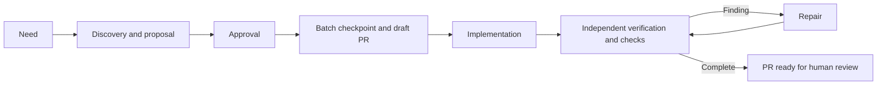

# AI Dev Workflows

A business need becomes a technical proposal. One approval starts implementation,
independent verification, repairs and required checks through a review-ready PR.
Merge and deployment remain separate decisions.

One `workflow` skill runs the same process in Codex, Cursor and Claude Code using
their native tools. One `BATCH.md` records the task; GitHub supplies current PR and
CI state. A new session can continue from those records.

## Use

After [installation](skills/install.md), invoke `$workflow <need>` in Codex or
`/workflow <need>` in Cursor/Claude Code. The agent inspects the project and presents
behavior, interface changes, decisions and proposed checks before approval.
Reply with your decisions or approve the presented proposal in ordinary language.

To continue, invoke the same skill with a batch path or PR and your request, such
as `continue this batch` or `address this feedback`. No separate delivery, feedback
or resume command is needed. Explicit planning-only and audit requests keep their
stated scope. The [entry contract](skills/workflow/SKILL.md) owns these boundaries.



The agent follows [prepare](skills/workflow/prepare.md) before approval and
[deliver](skills/workflow/deliver.md) afterwards. The independent verifier reads
[verify](skills/workflow/verify.md). Instructions are loaded for the current role
and stage. There is no custom orchestrator or publication receipt.

## Install or update

Open the application repository and give its agent this request:

```text
Read <source-repo>/skills/install.md. Install or update this workflow from the
source checkout's HEAD for the tools I use. Preserve project rules, local edits
and existing batches. Verify the package. Do not implement application code.
```

`<source-repo>` is the absolute path to this source checkout. `HEAD` means its
committed contents. Installation pins that commit; updates are explicit. See the
[installation procedure](skills/install.md) for discovery paths, version checking
and migration from the former five-skill package. Existing application copies and
old batches do not change when this source repository changes.

## Check and evaluate

```sh
python3 -B tests/validate_workflow.py
python3 -B tests/test_check_package.py
git diff --check
```

These check document structure and package comparison. They do not prove an
application works or an agent completes delivery. [Evaluation](tests/evaluation.md)
defines full-run criteria, maps all nine retained iteration reports and records
the limits of available evidence. Full trials require separately assigned tasks.

The [earlier modification plan](BLUEPRINT_MODIFICATION_PLAN.md) is historical
analysis, not the current instruction contract.
