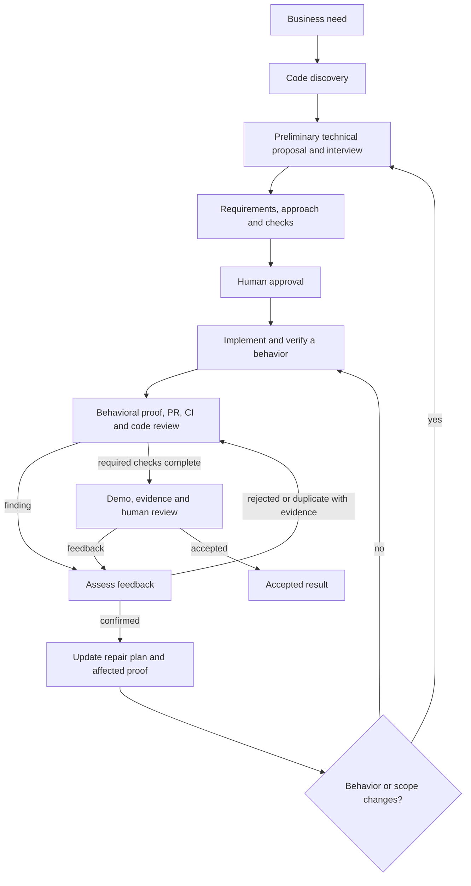

# AI Dev Workflows

Business need → code discovery and technical interview → agreed proposal → human
approval → implementation and verification → PR checks → human review.
Feedback is assessed and added to the plan before another implementation pass.
Native agents execute the workflow; the [blueprint](feature_execution_blueprint.md)
defines its rules.

## How to use

### 1. Install or refresh in an application

Open the **application repository** in Cursor, Claude Code, or Codex.
Use a local checkout of this source repository at the commit you want to install.
Replace `<source-repo>` with its absolute path and `<provider>` with your tool,
then paste into the agent chat:

```text
Read <source-repo>/skills/workflow-setup/SKILL.md.
Set up this workflow in the current application for <provider>.
If already installed, update the package from this source checkout's HEAD.
Preserve project rules, local edits, and batch documents.
Report the installed blueprint revision, source commit, and package verification.
Do not implement application code.
```

The agent installs the package in `ai-workflow/tooling/` and exposes five skills.
Open a **new chat** and confirm that `workflow-prepare` appears in the skill picker.
Repeat this step after source updates; application copies do not update automatically.
Use the same source commit for repeatable team installations.

### 2. Run a change

These are chat inputs. Replace `<need>`, `<batch>`, and `<feedback>` with your request.
The agent supplies the batch ID during preparation.

| Action | Cursor / Claude Code | Codex |
| --- | --- | --- |
| Prepare a proposal | `/workflow-prepare <need>` | `$workflow-prepare <need>` |
| Approve and deliver | `/workflow-deliver <batch>` | `$workflow-deliver <batch>` |
| Apply feedback | `/workflow-feedback <batch> <feedback>` | `$workflow-feedback <batch> <feedback>` |
| Resume interrupted work | `/workflow-resume <batch>` | `$workflow-resume <batch>` |

`prepare` first shows a preliminary solution: user behavior, technical changes,
interfaces and a flow diagram when useful. It asks only about unresolved expectations
and trade-offs, then turns the answers into a short proposal and verification plan.
It does not make you choose private helpers or repeat settled requirements.

Before `deliver`, review the proposed outcome, technical changes, risks,
and verification. The command approves the exact presented proposal and delivery
scope, including its commit/push/PR authority and destination. Missing authority
must be resolved first. At PR review, accept the result or send feedback.
Merge and deployment require separate authority; `resume` reuses existing approval.



One coordinator owns the result and delegates only with a concrete benefit.
A risk-focused plan review normally gets one pass and one repair confirmation.
Remaining uncertainty returns to code investigation or the interview, not another
round of prose review. PR creation is intermediate; pending CI/review is not a
verified handoff. Each requirement or decision has one canonical home, with
references from the plan and progress history instead of repeated specifications.

### 3. Check the installed version

In the application chat, replace the source path and ask:

```text
/workflow-setup Check the installed package version, integrity, and currentness
against <source-repo>, without changing files.
```

In Codex, use `$workflow-setup`. Each command identifies the blueprint revision
and recorded source commit. Setup checks file contents against that commit;
an intact older copy can still report an available update. Without access to the
source, verification is reported as unavailable.

## Details and checks

[Installation and updates](skills/install.md) ·
[Approval presentation](feature_execution_blueprint.md#approval-presentation) ·
[Session handoffs](feature_execution_blueprint.md#pipeline-and-handoffs)

```sh
python3 -B tests/validate_blueprint.py
python3 -B tests/test_check_package.py
git diff --check
```

These checks verify documentation and package comparison, not agent delivery.
The [proposal readiness regression case](tests/proposal_readiness_case.md) retains
one real proposal, fixed evaluation criteria, diagnosis, and the limits of its
review trial. It is supporting evidence, not an automated semantic quality gate.
The [4.2 forward check](tests/workflow_42_case.md) records one bounded intake and
feedback exercise, including what was not validated.
